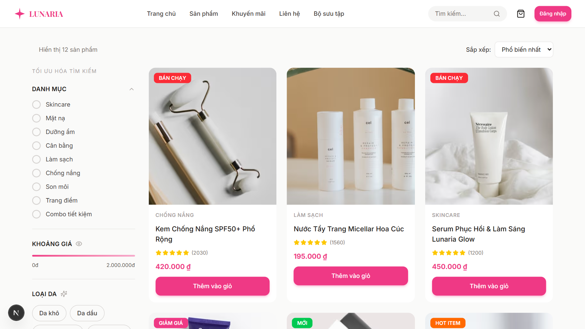
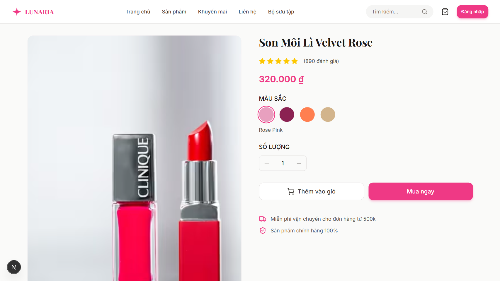
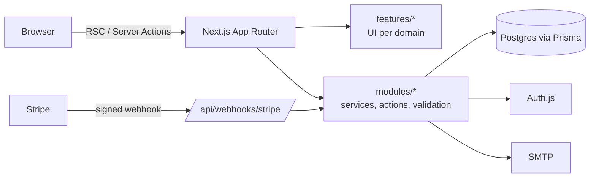

# Lunaria — cosmetics e-commerce platform

[](https://github.com/Quin19FD/lunaria-cosmetics-ecommerce-platform/actions/workflows/ci.yml)

A full-stack cosmetics store built with Next.js 15 (App Router), Prisma, Postgres, Auth.js and Stripe: a storefront, a checkout with real card payments, and an admin back office.


**Live demo:** <https://lunaria-bice.vercel.app> (sign in with the demo accounts below; card payment is not switched on there yet)

| Products                                          | Product detail                                        |
| ------------------------------------------------- | ----------------------------------------------------- |
|  |  |

## Features

**Storefront**

- Catalog with category, price and skin-type filters, sorting and search
- Product pages with variants (shade/size), image gallery and reviews
- Cart, wishlist, collections, promotions, order tracking
- Checkout with coupons, free shipping over 500,000 ₫, and payment by COD, bank transfer or card (Stripe Elements)
- Accounts: register, login, password reset by email, order history

**Admin (`/admin`)**

- CRUD for products (variants, images), brands, categories, collections, promotions and coupons
- Order management with status updates, manual order creation, review moderation
- User management; only `SUPER_ADMIN` can change roles

## Engineering highlights

- **Transactional order placement.** Stock is checked and decremented, and the coupon's usage is claimed atomically, inside one Prisma `$transaction`. Two buyers cannot oversell the last item or overuse a coupon.
- **Stripe webhook** verifies the signature and is idempotent: an order only moves `UNPAID → PAID`, so replays do nothing.
- **Server Actions are treated as public endpoints.** Every admin action calls `requireAdmin()`, which re-reads the role from the database, so a demoted admin loses access right away even with an old session token. An e2e test replays the admin role form from a customer session and asserts it is rejected.
- **Abandoned card checkouts release their stock.** A daily cron route cancels card orders left unpaid for over an hour: it cancels the Stripe PaymentIntent first, then restocks inside a transaction, and skips any order Stripe reports as paid.
- **Rate limiting** on login (failures only), registration, password reset and coupon checks, using a Postgres-backed fixed window that holds across serverless instances.
- Input validated with Zod, strict TypeScript with no `any`, `next/image` for product imagery, security headers, and `loading` / `error` / `not-found` routes.

## Tech stack

| Layer    | Tools                                                         |
| -------- | ------------------------------------------------------------- |
| Web      | Next.js 15 (App Router, Server Actions), React 19, TypeScript |
| UI       | Tailwind CSS 4, Framer Motion                                 |
| Data     | Postgres 17, Prisma 6 (migrations + seed)                     |
| Auth     | Auth.js v5 (credentials, JWT sessions)                        |
| Payments | Stripe (PaymentIntents, Elements, webhooks)                   |
| Email    | Nodemailer (SMTP)                                             |
| Tests    | Vitest (unit), Playwright (e2e)                               |
| CI       | GitHub Actions (Linux, Windows, macOS + Postgres service)     |

## Architecture



- `src/app` — routes, split into route groups: `(storefront)`, `(auth)`, `(admin)`.
- `src/features/<domain>` — UI for one domain (components, hooks), imported through its barrel `index.ts`.
- `src/modules/<domain>` — server-side logic: Server Actions, services, Zod schemas, Prisma queries.
- `src/components/ui` and `src/components/shared` — primitives and cross-feature components.

More detail on the layering and dependency rules: [docs/architecture.md](docs/architecture.md).

## Run locally

Requirements: Node.js 22, pnpm, Docker.

```bash
pnpm install
cp .env.example .env          # then fill in the values (see below)
docker compose up -d db       # Postgres 17 on localhost:5432
pnpm db:migrate:prod          # apply migrations
pnpm db:seed                  # sample catalog, users, orders, coupons
pnpm dev                      # http://localhost:3000
```

To run the production image instead: `docker compose up --build` (after migrating and seeding the database).

Environment variables (names only; see `.env.example`):

- `DATABASE_URL`, `AUTH_SECRET`, `NEXT_PUBLIC_APP_URL`
- Stripe (test mode): `STRIPE_SECRET_KEY`, `NEXT_PUBLIC_STRIPE_PUBLISHABLE_KEY`, `STRIPE_WEBHOOK_SECRET`
- Cron: `CRON_SECRET` (bearer token for `/api/cron/release-stale-orders`; the route answers 401 without it)
- Email: `SMTP_HOST`, `SMTP_PORT`, `SMTP_SECURE`, `SMTP_USER`, `SMTP_PASS`, `MAIL_FROM`

### Demo accounts (created by the seed)

| Role        | Email                  | Password   |
| ----------- | ---------------------- | ---------- |
| Super admin | `admin@lunaria.beauty` | `admin123` |
| Admin       | `staff@lunaria.beauty` | `staff123` |
| Customer    | `demo@lunaria.beauty`  | `123456`   |

These exist only in seeded development and demo databases. On the live demo the super admin password is different and private; use the admin or customer account. Stripe runs in test mode: use card `4242 4242 4242 4242`.

## Tests

```bash
pnpm check        # typecheck + lint + format check + unit tests
pnpm test         # unit tests (Vitest)
pnpm build && pnpm test:e2e   # Playwright e2e; needs a migrated + seeded database
```

CI runs `pnpm check` on Linux, Windows and macOS, and the build plus the Playwright suite against a Postgres service on Linux.
